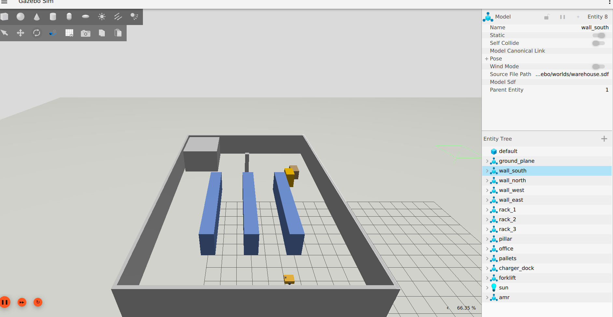
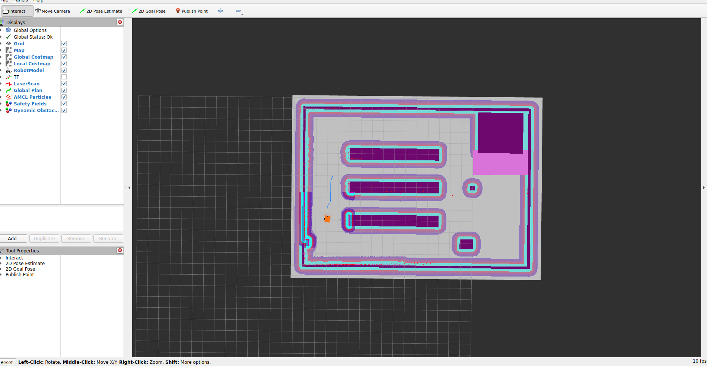
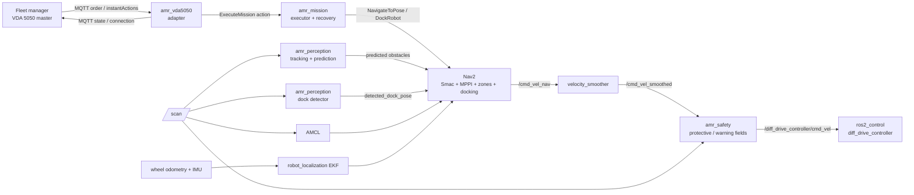

# ros2_warehouse_amr

[](https://github.com/subbu891/ros2_warehouse_amr/actions/workflows/ci.yml)

An autonomous mobile robot (AMR) for warehouse transport, built and validated like a product: SLAM mapping,
AMCL localization, Nav2 navigation with keepout and speed zones, a speed-dependent safety field monitor,
lidar tracking of moving forklifts, lidar-based docking, a mission executor with recovery, a **VDA 5050**
fleet interface over MQTT and an automated scenario test suite with measured KPIs.

**ROS 2 Jazzy · Gazebo Harmonic · Nav2 (Smac 2D, MPPI, docking) · slam_toolbox · robot_localization · ros2_control · Python · MQTT · VDA 5050 · Docker · GitHub Actions**





##Demo

https://github.com/user-attachments/assets/d605b276-83c6-459d-b872-e516b6521da4

https://github.com/user-attachments/assets/923c58af-1794-47bf-ac0c-b68c4eecc96d


## Architecture



The safety monitor is the only node that commands the wheels; every Nav2 output passes through it.

## Packages

| Package | Language | Content |
|---|---|---|
| `amr_description` | xacro | Differential-drive robot, 2D lidar, IMU, optional RGB-D camera, ros2_control |
| `amr_gazebo` | SDF, launch | Generated warehouse world, ROS-Gazebo bridge, moving forklift |
| `amr_navigation` | YAML, launch | EKF, slam_toolbox, AMCL, Nav2 (Smac 2D + MPPI), keepout and speed filters, docking |
| `amr_interfaces` | msg, action | `SafetyState`, `ExecuteMission` |
| `amr_safety` | Python | Speed-dependent protective and warning fields, docking field set, e-stop, watchdogs |
| `amr_perception` | Python | Moving obstacle tracking with motion prediction, lidar dock detection |
| `amr_mission` | Python | Mission executor with retries, recovery and staged docking |
| `amr_vda5050` | Python | VDA 5050 v2 adapter (MQTT) and a fleet manager tool |
| `amr_validation` | Python | KPI metrics, scenario runner, recorder, forklift driver |
| `amr_bringup` | launch | Full-stack launch, parameters, launch test |
| `tools` | Python, bash | World/map/zone generator, MQTT end-to-end check, simulation cleanup |

## Quick start

```bash
mkdir -p ~/amr_ws/src && cd ~/amr_ws/src
git clone https://github.com/subbu891/ros2_warehouse_amr.git
cd ~/amr_ws
rosdep install --from-paths src --ignore-src -y
colcon build --symlink-install
source install/setup.bash
ros2 launch amr_bringup bringup.launch.py
```

Send a transport mission:

```bash
ros2 action send_goal /execute_mission amr_interfaces/action/ExecuteMission "{mission_id: demo, steps: ['goto:pickup_a', 'wait:3', 'goto:drop_b', 'wait:3', 'goto:home']}" --feedback
```

Fleet interface over MQTT:

```bash
sudo service mosquitto start
ros2 launch amr_bringup bringup.launch.py vda5050:=true
ros2 run amr_vda5050 fleet_manager transport --pickup pickup_a --drop drop_c
```

## Validation results

Scenario suite, 9 scenarios with acceptance criteria defined before testing
(full report: [docs/results/scenario_report.md](docs/results/scenario_report.md)):

| Scenario | Key KPI | Target | Measured | Result |
|---|---|---|---|---|
| Nominal transport | Localization RMSE / max | ≤ 0.10 m / ≤ 0.30 m | 0.071 m / 0.137 m | PASS |
| Speed zone | Max speed in rack aisle | ≤ 0.46 m/s | 0.400 m/s | PASS |
| Keepout zone | Samples inside walkway | 0 | 0 | PASS |
| Forklift crossing | Clearance, forklift travel | ≥ 0.03 m, ≥ 2 m | 0.395 m, 7.7 m | FAIL (localization 0.120 m) |
| Sudden obstacle | Minimum clearance | ≥ 0.03 m | 0.429 m | PASS |
| Emergency stop | Stopping distance | ≤ 0.40 m | 0.067 m | PASS |
| Localization recovery | Convergence from 0.4 m / 0.2 rad error | ≤ 20 s | 7.0 s | PASS |
| Blocked aisle | Replan around unmapped pallet | mission success | success | PASS |
| Docking | Position / heading error | ≤ 0.05 m / ≤ 0.05 rad | see limitations | FAIL |

**7 of 9 scenarios pass.** 98 unit tests cover the safety logic, tracking, dock detection, mission logic,
VDA 5050 rules, KPI math, the robot model and the generated maps.

## Known limitations

| Topic | Observation | Likely cause | Next step |
|---|---|---|---|
| Docking reliability | Docked in 2 of 4 runs with 2.7 cm / 0.073 rad and 4.0 cm / 0.049 rad; the other 2 runs stopped at the staging pose | The dock detector or the docking server does not get a valid detection at the start of the final approach | Record detector output and docking server state per attempt; retry detection from the staging pose |
| Localization near the charger and in forklift traffic | AMCL RMSE 0.11 to 0.15 m in these two scenarios, 0.04 to 0.07 m elsewhere | Few distinctive features near the west wall; the forklift occludes the lidar | Reflector landmarks or scan matching against the map near docks |
| Run-to-run variance | Some KPIs vary between runs of the same scenario | Simulation timing on a CPU-only machine | Report each scenario as success rate over repeated runs (`--repeat 10`) |
| Safety | The safety monitor models a safety laser scanner | Not certified hardware | Certified scanner and safety PLC on a real robot (ISO 13849, ISO 3691-4) |

## Testing

| Level | Command |
|---|---|
| Unit tests (no ROS) | `python3 -m pytest` |
| Package tests | `colcon test && colcon test-result --verbose` |
| Launch test | `colcon build --packages-select amr_bringup --cmake-args -DAMR_INTEGRATION_TESTS=ON && colcon test --packages-select amr_bringup` |
| Scenario suite | `bash tools/clean_sim.sh`, start the stack headless, then `ros2 run amr_validation scenario_runner` |
| VDA 5050 protocol | `PYTHONPATH=amr_vda5050 python3 tools/vda5050_mqtt_e2e.py` |

Details: [docs/TEST_PLAN.md](docs/TEST_PLAN.md) · Safety: [docs/SAFETY_CONCEPT.md](docs/SAFETY_CONCEPT.md)

## Engineering notes

Integration issues found and fixed during validation:

- Costmap filters were silently inactive because relative topic names resolved inside the costmap namespaces; fixed with absolute topics.
- Behaviour tree goals aborted under CPU load because the 20 ms server acknowledgement timeout was too short; raised to 1 s.
- The docking server rejected the dock database because of a sequence/map schema mismatch.
- Localization KPIs were biased by comparing messages by arrival time; switched to message stamps in simulation time.
- Localization-based docking ended 21 cm short; lidar dock detection plus a docking safety field set reached 2.7 cm.
- A blind simulated forklift collided with the stopped robot; the forklift now brakes like a driver, and the test proves it really moved.

## License

Apache-2.0
